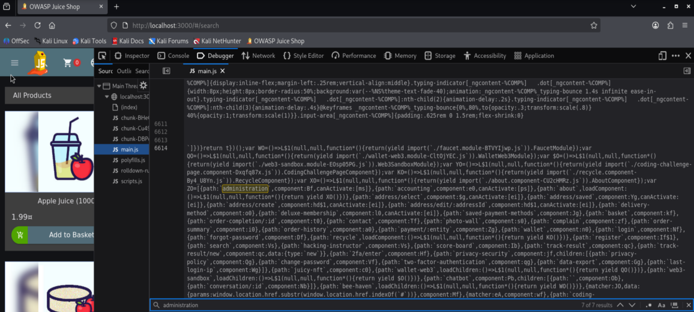
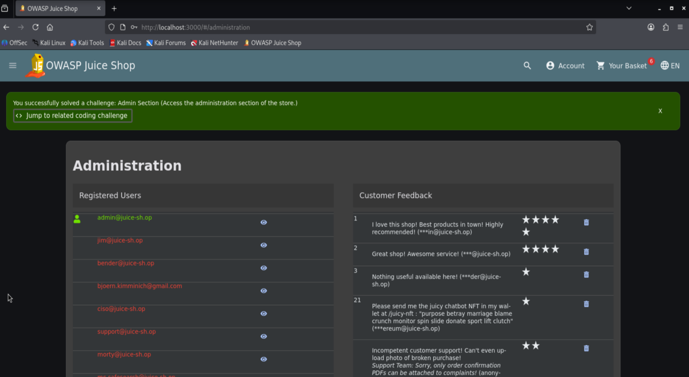
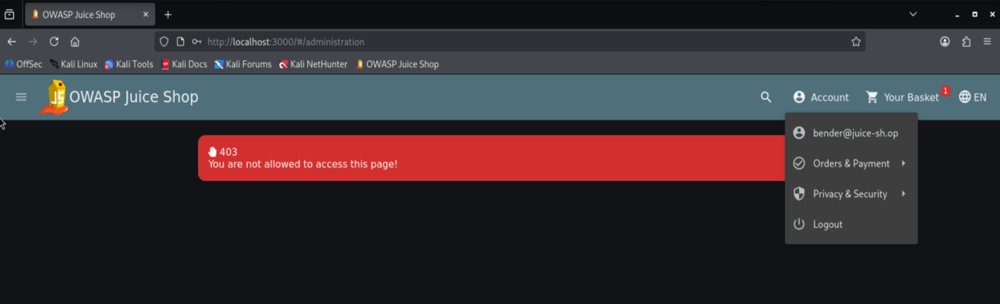
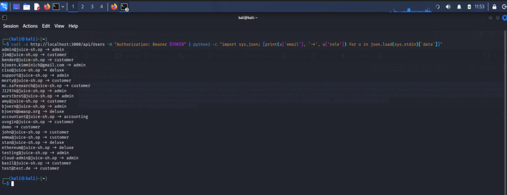

# Admin Section

> **Educational purpose only.** This documentation describes a vulnerability in the OWASP Juice Shop, an intentionally vulnerable training application. It is provided for educational and defensive purposes and was reproduced on a local instance only.

**Category:** Broken Access Control
**OWASP mapping:** A01:2021 Broken Access Control
**Difficulty:** 1 star
**Video:** https://www.loom.com/share/29f50be18013416396758588b76d66ee

## Table of Contents

- [Overview](#overview)
- [Why it is dangerous](#why-it-is-dangerous)
- [Reproduction](#reproduction)
- [Root cause](#root-cause)
- [Mitigation](#mitigation)
- [References](#references)

## Overview

The Juice Shop has an administration section that is not linked anywhere in the navigation. The route exists in the client side application and can be found by reading the JavaScript bundle. In the browser the page is gated by a client side guard, so a normal customer is redirected away. That guard runs only in the browser, and the API behind the administration view does not enforce authorization on the server. A normal customer can therefore call the user endpoint directly and read the full user table, which makes this a Broken Access Control finding combined with security through obscurity.

## Why it is dangerous

The administration view exposes the list of registered users and the customer feedback. The real problem is deeper than the hidden page: the endpoint that backs it returns all user records to any authenticated user, regardless of role. That includes email addresses, assigned roles, and password hashes. A single logged in customer can pull the entire user base without ever being an administrator. The wider impact is mass disclosure of personal data and credentials, a direct path to privilege escalation and account takeover, and a reportable data breach. It also shows the trap of relying on a hidden route and a browser guard: both give a false sense of protection while the server quietly hands out the data.

## Reproduction

**Preconditions:**

- Local instance running on `http://localhost:3000`
- A customer account and its Bearer token (see Step 4)
- An administrator session for the UI part of Step 2 (via the [Login Admin](../login-admin/index.md) SQL injection)

### Step 1: Find the hidden route in the client code

1. Open the browser developer tools with F12 and go to the **Debugger** tab.
2. In the file tree under `localhost:3000`, open `main.js`.
3. Search the file with Ctrl and F for `administration`. The route is defined as `path:'administration'` with a client side guard next to it.

The route is shipped to every visitor, so it is not secret despite being unlinked.



### Step 2: Access the page with an administrator session

1. Without a valid session, enter the route directly in the address bar and note that access is refused:

   ```text
   http://localhost:3000/#/administration
   ```

2. Log in as administrator using the SQL injection from the Login Admin challenge.
3. Open the route again. The administration section now loads and shows the registered users and the customer feedback. The challenge is marked solved.



### Step 3: Confirm the browser guard blocks a normal customer

1. Log in as a normal customer (for example `bender@juice-sh.op`, role `customer`).
2. Try to open `http://localhost:3000/#/administration` again. The client side guard redirects you away, so the page looks protected.



### Step 4: Bypass the guard through the API

The guard runs only in the browser. Calling the API directly goes around it entirely.

1. Read the customer's token from the developer tools: **Storage** tab, **Local Storage**, entry `token`. Keep it in a shell variable (do not commit it anywhere):

   ```bash
   USER_TOKEN="<paste the customer token here>"
   ```

2. Request the user endpoint directly with the customer token:

   ```bash
   curl -s http://localhost:3000/api/Users -H "Authorization: Bearer $USER_TOKEN"
   ```

3. The server responds with 200 and returns the full user table, including email addresses, roles, and password hashes, to a plain customer.



**Result:** The administration view is reachable and, more importantly, the backing endpoint exposes all user records to any authenticated user. This proves the protection lived only in the browser.

## Root cause

Two weaknesses combine. First, the administration route is only hidden, not protected: it is defined in `frontend/src/app/app.routing.ts` and gated by a client side guard in `frontend/src/app/admin-guard/admin.guard.ts`, both shipped to the browser where an attacker can read and bypass them. Second, and more serious, the user endpoint does not enforce authorization on the server, so it returns the full user table to any authenticated caller regardless of role. Hiding a route and guarding it in the client are not access control, because the routing table is public in the bundle and the guard runs in code the attacker controls. The server must decide access on every request.

## Mitigation

Enforce authorization on the server for every sensitive route and API endpoint, based on the authenticated user's role, and deny by default. A client side guard is only a user experience convenience, never the protection. Hiding a route is not protection at all.

Vulnerable (endpoint returns data to any authenticated user):

```js
app.get('/api/Users', (req, res) => {
  res.json(getAllUsers())
})
```

Secure (server verifies the role before serving):

```js
function requireAdmin (req, res, next) {
  if (req.user?.role !== 'admin') return res.sendStatus(403)
  next()
}

app.get('/api/Users', requireAdmin, (req, res) => {
  res.json(getAllUsers())
})
```

**Key takeaways:**

- Enforce access control server side on every request and deny by default. A customer token must never return admin data.
- Do not rely on hidden routes or client side guards. Anything shipped to the browser is visible and controllable by the attacker.

## References

- OWASP Juice Shop project: https://owasp.org/www-project-juice-shop/
- OWASP Top 10 A01:2021 Broken Access Control: https://owasp.org/Top10/A01_2021-Broken_Access_Control/
- OWASP Authorization Cheat Sheet: https://cheatsheetseries.owasp.org/cheatsheets/Authorization_Cheat_Sheet.html