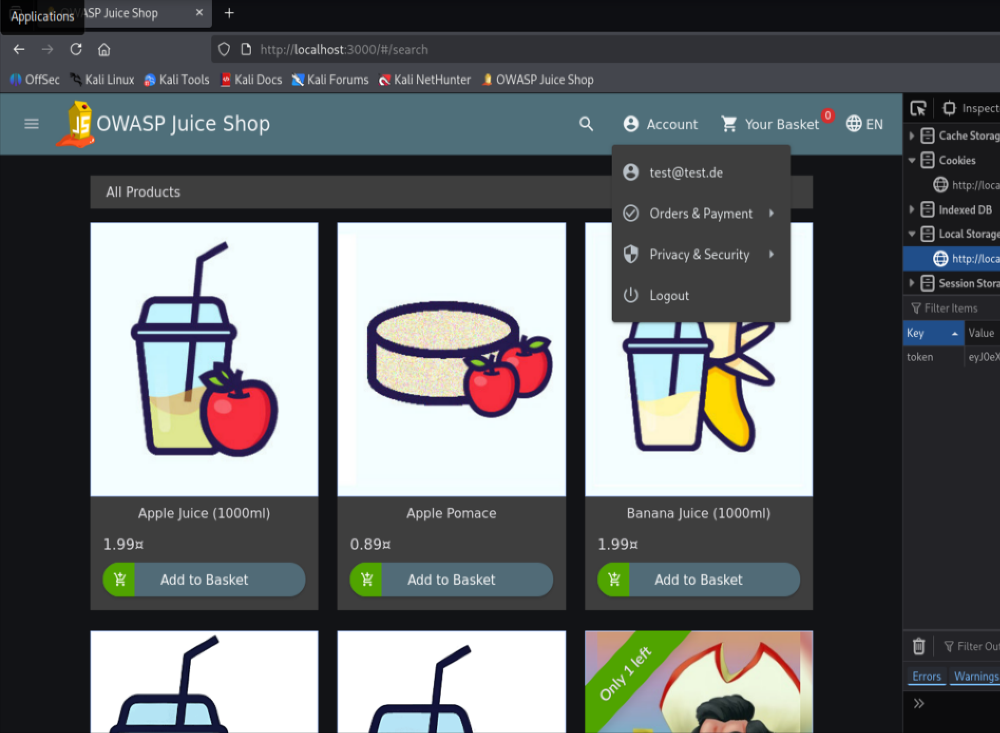

# API-only XSS

> **Educational purpose only.** This documentation describes a vulnerability in the OWASP Juice Shop, an intentionally vulnerable training application. It is provided for educational and defensive purposes and was reproduced on a local instance only.

**Category:** Cross Site Scripting (XSS)
**OWASP mapping:** A03:2021 Injection / XSS
**Difficulty:** 3 stars
**Video:** _TODO: add Loom link (max 5 minutes)_

## Table of Contents

- [Overview](#overview)
- [Why it is dangerous](#why-it-is-dangerous)
- [Reproduction](#reproduction)
- [Root cause](#root-cause)
- [Mitigation](#mitigation)
- [References](#references)

## Overview

The product REST API accepts updates to product fields and stores them without sanitising the input on the server. The web interface sanitises what a user types and does not even offer a product description editor, so the payload cannot be introduced through the UI. It can only be planted by calling the API directly. Once stored, the malicious markup is served to every visitor who opens that product, which makes this a stored (persistent) Cross Site Scripting finding that also demonstrates why client side sanitisation is not a security control.

## Why it is dangerous

Unlike a reflected payload that only affects the person who clicks a crafted link, a stored payload is persisted in the database and executed in the browser of every user who views the affected product. One request by the attacker compromises all future visitors, including administrators. In the context of each victim's session the script can read or exfiltrate the session token, act on the victim's behalf, scrape personal data, or redirect to a phishing page. Because the injection path is the API and bypasses the frontend entirely, any defence that lives only in the client is useless. The wider impact is mass account takeover, theft of personal data at scale, and persistent defacement, all triggered by a single stored entry.

## Reproduction

**Preconditions:**

- Local instance running on `http://localhost:3000`
- A throwaway test account (register one in the app)
- The account's Bearer token (see Step 1)

### Step 1: Obtain a Bearer token

1. Register and log in with a throwaway test account in the application.
2. Capture the token. The quickest way is the browser developer tools console:

   ```js
   localStorage.getItem('token')
   ```

   Keep it in a shell variable for the next step (do not commit it anywhere):

   ```bash
   TOKEN="<paste the token here>"
   ```



### Step 2: Plant the payload through the API

Send a direct API request to update a product description with an HTML payload. This cannot be done through the UI, which is the point of the challenge.

```bash
curl -X PUT http://localhost:3000/api/Products/1 \
  -H "Authorization: Bearer $TOKEN" \
  -H "Content-Type: application/json" \
  -d '{"description":"<iframe src=\"javascript:alert(`xss`)\">"}'
```

A successful response returns the updated product JSON, now carrying the injected description.


### Step 3: Trigger the stored payload

1. Open the affected product in the browser, for example by searching for it and opening its detail view:

   ```text
   http://localhost:3000/#/search?q=apple
   ```

2. When the product detail renders the description, the injected markup executes and an `xss` alert appears. The challenge is marked solved.


**Result:** The payload is stored server side and executes for anyone who views the product. The challenge success notification appears.

### Optional: demonstrate real impact (local only)

To show why this matters beyond an alert box, replace the payload with one that exfiltrates the session token to a local listener. This stays entirely on your machine.

Start a listener in a second terminal:

```bash
python3 -m http.server 8000
```

Plant a payload that sends the victim's token to it:

```text

```

When the product is viewed, the token appears in the listener log. Do not commit the captured token anywhere.

## Root cause

Two weaknesses combine. First, the product API writes user supplied field values to the database without server side sanitisation, trusting the frontend to have cleaned the input. Second, the product description is later rendered as raw HTML in the product detail view, using the frontend's trusted HTML binding rather than text binding, so stored markup reaches the DOM and runs. The frontend both performs the only sanitisation and is the only place a normal user can edit, which is why calling the API directly bypasses the control entirely. Sanitisation and output encoding belong on the server and at the render sink, not in the editor the attacker can skip.

## Mitigation

Validate and sanitise untrusted input on the server when it is written, and encode output for its context when it is rendered. Never rely on the client to sanitise, because the API can always be called directly.

Vulnerable (API stores the value as sent, UI renders it as HTML):

```ts
// write: value stored verbatim
await ProductModel.update({ description: req.body.description }, { where: { id } })
// render: trusted as HTML
this.description = this.sanitizer.bypassSecurityTrustHtml(product.description)
```

Secure (sanitise on write, bind as text on render):

```ts
// write: sanitise server side with a vetted sanitiser
await ProductModel.update({ description: sanitizeHtml(req.body.description) }, { where: { id } })
// render: let the framework escape it
// template: <p>{{ description }}</p>
```

A good production example of doing this correctly is Shopware 6. Since version 6.5 it runs a server side HTML sanitiser (HTMLPurifier based) in its data write layer, so fields are cleaned regardless of whether the write comes from the admin UI or directly from the API, and plain text fields reject HTML entirely. That is exactly the server side enforcement the Juice Shop is missing here.

**Key takeaways:**

- Sanitise untrusted input on the server at write time and encode output at the render sink. Client side sanitisation is not a security boundary because the API can be called directly.
- Prefer text binding over HTML binding, and add a Content Security Policy as defence in depth.

## References

- OWASP Juice Shop project: https://owasp.org/www-project-juice-shop/
- OWASP Top 10 A03:2021 Injection: https://owasp.org/Top10/A03_2021-Injection/
- OWASP Cross Site Scripting Prevention Cheat Sheet: https://cheatsheetseries.owasp.org/cheatsheets/Cross_Site_Scripting_Prevention_Cheat_Sheet.html
- Shopware HTML Sanitizer: https://docs.shopware.com/en/en/shopware-6-en/html-sanitizer