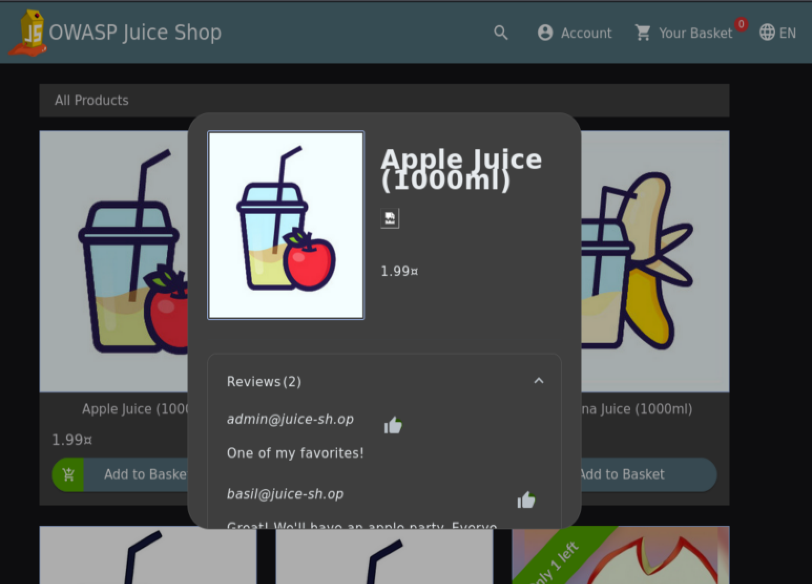
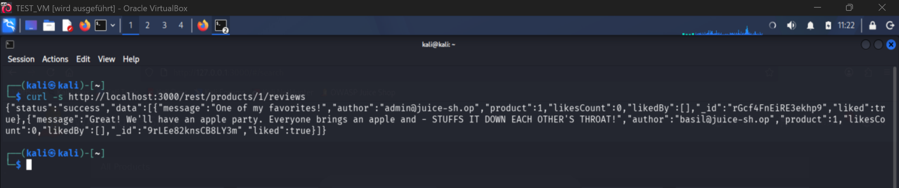
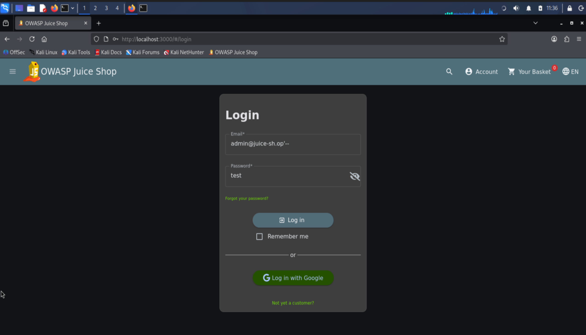
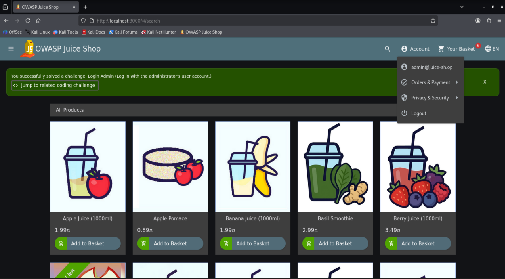

# Login Admin

:::warning Educational purpose only

This documentation describes a vulnerability in the OWASP Juice Shop, an intentionally vulnerable training application. It is provided for educational and defensive purposes and was reproduced on a local instance only.

:::

**Category:** Injection (SQL Injection)
**OWASP mapping:** A03:2021 Injection
**Difficulty:** 2 stars
**Video:** https://www.loom.com/share/20017eaa985a4a2eaf250adf86e004fe

## Table of Contents

- [Overview](#overview)
- [Why it is dangerous](#why-it-is-dangerous)
- [Reproduction](#reproduction)
- [Root cause](#root-cause)
- [Mitigation](#mitigation)
- [References](#references)

## Overview

The login form of the Juice Shop builds its database query by concatenating the submitted email directly into a SQL statement. By injecting SQL syntax into the email field, an attacker can change the meaning of the query and authenticate as any user without knowing a password. This challenge targets the administrator account and results in a full administrative session.

## Why it is dangerous

A successful login bypass gives the attacker the administrator session, which exposes the administration area, all customer orders, and the ability to act on behalf of other users. Because the query returns the first matching row, the attacker does not even need valid credentials, only knowledge that the field is injectable. The wider impact is severe: SQL injection in an authentication path can lead to full account takeover, disclosure of the entire user table, tampering with orders and products, and in many real applications to reading or modifying arbitrary data in the database. For the business this means loss of customer trust, data breach notification obligations, and potential full compromise of the application.

## Reproduction

**Preconditions:**

- Local instance running on `http://localhost:3000`
- No prior login required

### Step 1: Find the administrator email

You can skip this step and still solve the challenge (see the note in Step 3), but knowing the target email lets you log in as a specific account instead of whichever user happens to be first in the table. Two ways to obtain it:

**Option A: via the product reviews (UI)**

The Juice Shop shows the author email next to product reviews, which leaks the administrator address.

1. Open the application and click on any product to open its detail dialog.
2. Scroll to the reviews. The author email is displayed next to each review.
3. Note the administrator address that appears in the reviews:

   ```text
   admin@juice-sh.op
   ```



**Option B: via the REST API**

The product reviews endpoint returns the review authors, including their email, as JSON.

1. Request the reviews for a product directly:

   ```bash
   curl http://localhost:3000/rest/products/1/reviews
   ```

2. In the JSON response, read the `author` field of the reviews. The administrator address appears there:

   ```text
   admin@juice-sh.op
   ```



### Step 2: Confirm the login field is injectable

Before crafting the full payload, a single quote shows whether the input reaches the SQL query unescaped. This is the step that reveals SQL injection is even possible here.

1. Open the login page at `http://localhost:3000/#/login`.
2. In the **Email** field, enter a single quote and any password:

   ```text
   '
   ```

3. Submit the form. The server answers with a `500` error whose message leaks the raw SQL statement, along the lines of `SQLITE_ERROR: unrecognized token` followed by the full `SELECT * FROM Users WHERE email = '''...` query. Seeing the quote break the query proves the email value is concatenated into the SQL unescaped, which is exactly the flaw the next step exploits.

### Step 3: Bypass the login with SQL injection

1. Back on the login page at `http://localhost:3000/#/login`.
2. In the **Email** field, enter the targeted payload. The trailing `'` closes the string literal and `--` comments out the rest of the query, including the password check. Note the required trailing space after `--` (SQLite).

   ```text
   admin@juice-sh.op'--
   ```

3. In the **Password** field, enter any value (it is ignored because it is commented out).
4. Submit the form.

> **Note:** If you skipped Step 1, use `' OR 1=1-- ` in the Email field instead. This makes the condition always true and logs you in as the first user in the table, which is the administrator (ID 1).



**Result:** You are logged in as the administrator without a valid password. The challenge is marked solved and the success notification appears. You now have an administrative session and can reach the administration area.



## Root cause

The login handler builds the SQL query by concatenating the user supplied email directly into the statement, instead of using parameterised queries. In the Juice Shop source the vulnerable code is in `routes/login.js`, where the query is assembled roughly as:

```js
models.sequelize.query(
  `SELECT * FROM Users WHERE email = '${req.body.email || ''}' AND password = '${security.hash(req.body.password || '')}' AND deletedAt IS NULL`
)
```

Because the email value is inserted into the query text verbatim, injected characters such as `'` and `--` are parsed as SQL rather than treated as data. This breaks the boundary between code and input, which is the defining flaw of SQL injection.

## Mitigation

Never build SQL by string concatenation with user input. Use parameterised queries or the ORM so that input is always bound as a value and can never be interpreted as SQL. With Sequelize this means replacements or the model query methods.

Vulnerable (input concatenated into the query):

```js
models.sequelize.query(
  `SELECT * FROM Users WHERE email = '${req.body.email}' AND password = '${hash(req.body.password)}'`
)
```

Secure (input bound as parameters):

```js
models.sequelize.query(
  'SELECT * FROM Users WHERE email = :email AND password = :password AND deletedAt IS NULL',
  { replacements: { email: req.body.email, password: hash(req.body.password) }, type: QueryTypes.SELECT }
)
```

Even cleaner is to avoid raw SQL entirely and let the ORM build the query:

```js
const user = await UserModel.findOne({ where: { email: req.body.email, password: hash(req.body.password) } })
```

**Key takeaways:**

- Use parameterised queries or ORM methods so user input is bound as data, never concatenated into SQL.
- Apply input validation and least privilege at the database layer as defence in depth, but parameterisation is the primary fix.

## References

- OWASP Juice Shop project: https://owasp.org/www-project-juice-shop/
- OWASP SQL Injection: https://owasp.org/www-community/attacks/SQL_Injection
- OWASP SQL Injection Prevention Cheat Sheet: https://cheatsheetseries.owasp.org/cheatsheets/SQL_Injection_Prevention_Cheat_Sheet.html